# COMPREHENSIVE SYSTEM DOCUMENTATION & ENHANCEMENT REPORT
**University of Abra (UA) School Website Enhancement Project**  
**Subject:** Web Systems and Technologies  
**Proponent:** Individual Student Submission  
**Reference Website:** [https://asist.edu.ph/](https://asist.edu.ph/) (University of Abra, formerly ASIST)  
**Governing Charter:** Republic Act No. 11574  
**Framework & Database:** Python 3 (Flask) + SQLite3 + HTML5 / CSS3  
**Screenshot Folder:** `screenshots/`  

---

## TABLE OF CONTENTS
1. [Executive Summary & Core Enhancement Objectives](#1-executive-summary--core-enhancement-objectives)
2. [Comprehensive Page-by-Page Documentation & Enhancements](#2-comprehensive-page-by-page-documentation--enhancements)
   * [Page 1: Homepage (`/`)](#page-1-homepage-)
   * [Page 2: About the University (`/about`)](#page-2-about-the-university-about)
   * [Page 3: Courses & Programs Catalog (`/courses`)](#page-3-courses--programs-catalog-courses)
   * [Page 4: Courses Filtered by Campus (`/courses?campus=Bangued`)](#page-4-courses-filtered-by-campus)
   * [Page 5: Online Admission Application (`/apply`)](#page-5-online-admission-application-apply)
   * [Page 6: Application Confirmation & Printable Slip (`/apply/success/<ref>`)](#page-6-application-confirmation--printable-slip-applysuccessref)
   * [Page 7: Admission Status Tracker (`/status`)](#page-7-admission-status-tracker-status)
   * [Page 8: Student Portal Login (`/portal` - Unauthenticated)](#page-8-student-portal-login-portal---unauthenticated)
   * [Page 9: Student Portal Dashboard (`/portal` - Authenticated)](#page-9-student-portal-dashboard-portal---authenticated)
   * [Page 10: Campus News & Bulletins (`/news`)](#page-10-campus-news--bulletins-news)
   * [Page 11: Contact Us & Campus Directory (`/contact`)](#page-11-contact-us--campus-directory-contact)
   * [Page 12: Admin & Evaluator View (`/admin`)](#page-12-admin--evaluator-view-admin)
3. [Summary Matrix: Old Website Limitations vs. New Enhancements](#3-summary-matrix-old-website-limitations-vs-new-enhancements)
4. [Database Architecture & Data Dictionary](#4-database-architecture--data-dictionary)
5. [Oral Defense Presentation Guide & Talking Points](#5-oral-defense-presentation-guide--talking-points)

---

## 1. EXECUTIVE SUMMARY & CORE ENHANCEMENT OBJECTIVES

The **University of Abra (UA)**, formerly the *Abra State Institute of Sciences and Technology (ASIST)*, is the premier higher education institution in the province of Abra, officially converted into a state university under **Republic Act No. 11574**.

While the institution has achieved university status, an audit of its existing official website ([asist.edu.ph](https://asist.edu.ph/)) revealed significant usability bottlenecks:
1. An outdated, non-responsive design that breaks on mobile devices.
2. The total absence of an online admission and registration system for prospective high school graduates.
3. No mechanism for applicants to track their examination status or room assignments online.
4. Fragmented, hard-to-access student services with broken SIAS links.
5. Inability to filter courses across its three distinct campuses (**Lagangilang**, **Bangued**, and **La Paz**).

This project was built to directly address every single one of these limitations by creating a clean, user-friendly, fully functional web portal using **Python Flask** and **SQLite3**, adhering to the official university colors of **Forest Green (`#0d5c3a`)** and **Gold (`#f4c430`)**.

---

## 2. COMPREHENSIVE PAGE-BY-PAGE DOCUMENTATION & ENHANCEMENTS

---

### PAGE 1: HOMEPAGE
* **URL Route:** `http://127.0.0.1:5000/`
* **Template File:** `templates/index.html`
* **HTTP Method:** `GET` | **Controller Function:** `index()` in `app.py`

#### Page Screenshot:
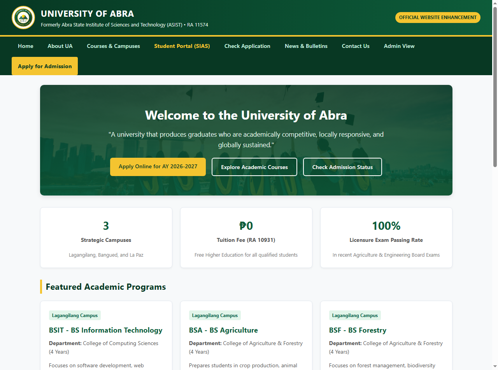

#### About & Purpose of the Page:
The Homepage is the primary digital front door of the University of Abra. It greets incoming freshmen, current students, faculty, and community visitors with an authoritative, modern presentation of the university's mandate, academic excellence, and latest events.

#### Limitations of the Original Website (`asist.edu.ph`):
* The existing homepage uses a dated, cluttered layout with low-contrast text and non-responsive tables that fail to adapt to mobile phones.
* Important university achievements, tuition-free policies, and admission deadlines are buried inside obscure menus.
* Lacks clear, visible "Call-to-Action" (CTA) buttons to guide visitors toward applying or tracking their applications.

#### Specific Enhancements Implemented in This Project:
1. **Modern School Color Branding:** Built with the official University of Abra colors (Forest Green `#0d5c3a` and Gold `#f4c430`), featuring the official university vector seal and a prominent Republic Act No. 11574 banner.
2. **Prominent Hero Banner & CTAs:** A bold welcoming hero banner showcasing the university vision with three direct action buttons: *Apply Online*, *Explore Courses*, and *Check Status*.
3. **Quick Institutional Statistics Cards:** High-visibility cards highlighting key university strengths: **3 Campuses** (Lagangilang, Bangued, La Paz), **₱0 Tuition Fee** (RA 10931 Free Higher Education), and **100% PRC Licensure Passing Rate** in Agriculture and Engineering.
4. **Featured Courses Showcase:** Previews top academic degrees with direct application links.
5. **Real-Time News Stream:** Dynamically pulls the top 3 latest official announcements from SQLite.

---

### PAGE 2: ABOUT THE UNIVERSITY
* **URL Route:** `http://127.0.0.1:5000/about`
* **Template File:** `templates/about.html`
* **HTTP Method:** `GET` | **Controller Function:** `about()` in `app.py`

#### Page Screenshot:
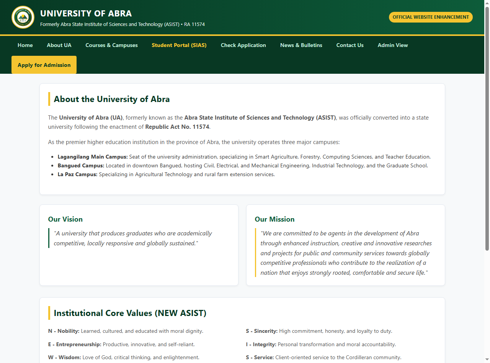

#### About & Purpose of the Page:
This page serves as the official institutional profile of the University of Abra, articulating its historical transition, campus structure, official vision and mission statements, and core institutional values.

#### Limitations of the Original Website (`asist.edu.ph`):
* Historical information on the conversion from ASIST to University of Abra is unorganized and scattered across outdated PDF links.
* Institutional Vision, Mission, and Core Values are buried in hard-to-read text without visual hierarchy or mobile readability.

#### Specific Enhancements Implemented in This Project:
1. **Clear Statutory Transition History:** Explains the evolution from ASIST to the University of Abra under **Republic Act No. 11574**.
2. **Three-Campus Structural Breakdown:** Clearly outlines the specialization of each campus:
   * *Lagangilang Main Campus:* Administrative seat, Smart Agriculture, Forestry, Computing Sciences, and Teacher Education.
   * *Bangued Campus:* Downtown engineering and technology powerhouse, housing Civil, Mechanical, and Electrical Engineering, Industrial Tech, and Graduate Studies.
   * *La Paz Campus:* Specialized Agricultural Technology and rural farm extension.
3. **Formatted Vision & Mission Cards:** Styled in high-contrast callout boxes with green and gold border accents for immediate readability.
4. **Structured NEW ASIST Core Values Grid:** A clean 2-column breakdown of the 8 institutional pillars: **N**obility, **E**ntrepreneurship, **W**isdom, **A**ction, **S**incerity, **I**ntegrity, **S**ervice, and **T**eamwork.

---

### PAGE 3: COURSES & PROGRAMS CATALOG
* **URL Route:** `http://127.0.0.1:5000/courses`
* **Template File:** `templates/courses.html`
* **HTTP Method:** `GET` | **Controller Function:** `courses()` in `app.py`
* **Database Table Queried:** `programs`

#### Page Screenshot:
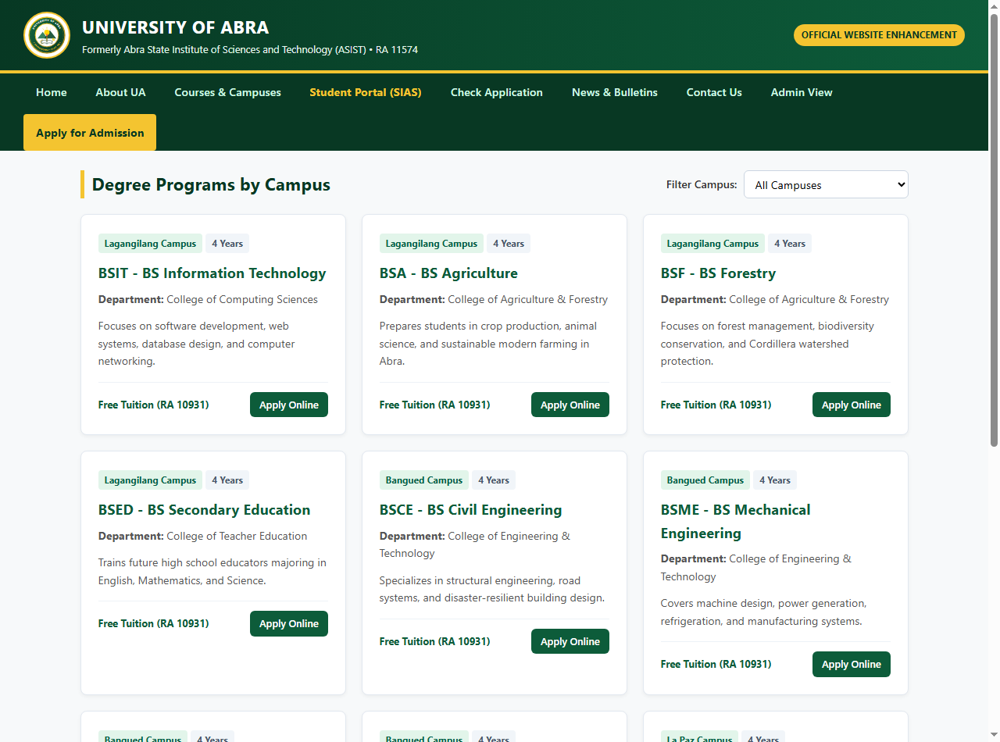

#### About & Purpose of the Page:
The Courses Catalog provides an exhaustive, centralized directory of all undergraduate and technical degree programs offered by the University of Abra.

#### Limitations of the Original Website (`asist.edu.ph`):
* Courses are listed in long, static HTML tables where programs across all three campuses are lumped together without filtering.
* Prospective students cannot easily determine which campus offers a particular program, causing confusion between Lagangilang and Bangued offerings.
* Does not indicate course duration, department affiliation, or the Free Higher Education Act subsidy.

#### Specific Enhancements Implemented in This Project:
1. **Card-Based Program Grid:** Each course is displayed in a modern card highlighting its official Code (`BSIT`, `BSA`, `BSCE`, `BSED`), Title, College Department, and Duration (4 Years).
2. **Campus Assignment Badges:** Clear colored badges immediately identify whether the course is held in Lagangilang Main, Bangued, or La Paz.
3. **RA 10931 Zero-Tuition Guarantee:** Reminds prospective students that all undergraduate programs are 100% tuition-free for qualified Filipinos.
4. **Direct One-Click Application Link:** Every course card includes an *"Apply Online"* button that takes the student directly to the admission form.

---

### PAGE 4: COURSES FILTERED BY CAMPUS
* **URL Route:** `http://127.0.0.1:5000/courses?campus=Bangued`
* **Template File:** `templates/courses.html`

#### Page Screenshot:
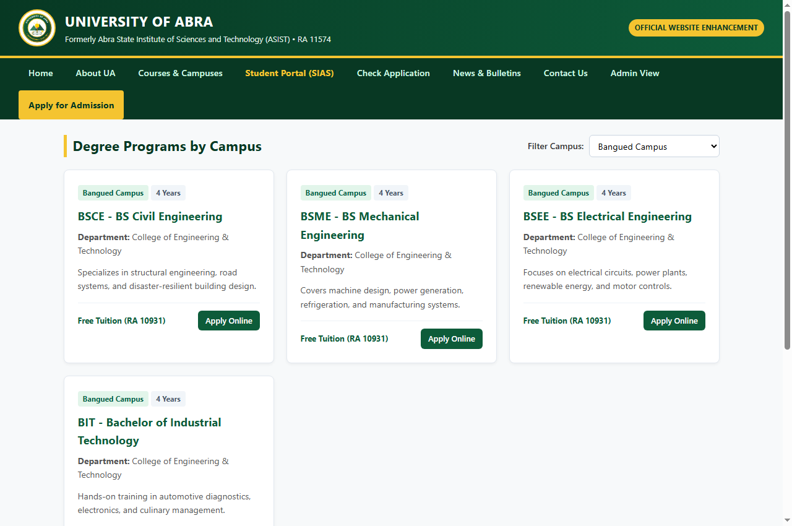

#### About & Purpose of the Page:
Demonstrates the dynamic campus filtering capability in action when a user chooses a specific campus from the dropdown (e.g. Bangued Campus).

#### Limitations of the Original Website (`asist.edu.ph`):
* The old site has zero dynamic filtering; users are forced to manually scroll and guess which college is located in which municipality.

#### Specific Enhancements Implemented in This Project:
1. **Dynamic Server-Side SQL Filtering:** Changing the dropdown sends a clean query parameter (`?campus=Bangued`), prompting Flask to execute:
   `SELECT * FROM programs WHERE campus LIKE '%Bangued%'`
2. **Instant Visual Feedback:** Displays only the engineering, industrial technology, and specialized urban programs of Bangued (*BS Civil Engineering, BS Mechanical Engineering, BS Electrical Engineering, Bachelor of Industrial Technology*).
3. **Campus Selection Persistence:** The dropdown retains the selected campus state after filtering so the user never loses context.

---

### PAGE 5: ONLINE ADMISSION APPLICATION
* **URL Route:** `http://127.0.0.1:5000/apply`
* **Template File:** `templates/apply.html`
* **HTTP Methods:** `GET`, `POST` | **Controller Function:** `apply()` in `app.py`
* **Database Table Updated:** `applicants`

#### Page Screenshot:
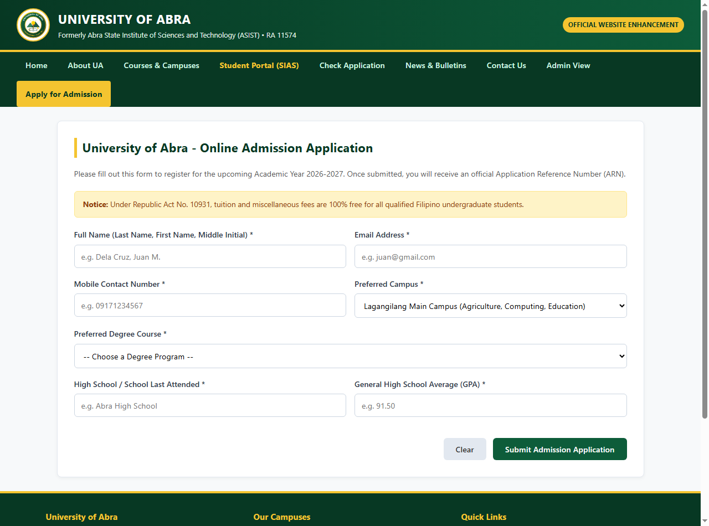

#### About & Purpose of the Page:
A completely paperless online admission portal where incoming high school graduates and transferees can register for the upcoming academic year.

#### Limitations of the Original Website (`asist.edu.ph`):
* **No online admission exists on the current website.** Applicants must either travel in person to the university registrar in Abra or download manual PDF forms to submit by hand.
* Results in long lines, delayed evaluations, manual encoding errors, and barriers for applicants residing outside Abra.

#### Specific Enhancements Implemented in This Project:
1. **100% Paperless Online Registration:** Allows applicants to apply from any smartphone or computer without traveling to the campus.
2. **Structured Form Fields:** Captures applicant full name, valid email, mobile phone number, preferred campus, chosen degree course, previous school attended, and general average (GPA).
3. **Dynamic Course Dropdown:** The course selection dropdown is automatically populated from the `programs` database table, ensuring applicants only select valid offerings.
4. **Instant Database Persistence:** Upon clicking *"Submit Admission Application"*, the server automatically generates a unique reference number, inserts the record into SQLite, and displays the confirmation slip.

---

### PAGE 6: APPLICATION CONFIRMATION & PRINTABLE SLIP
* **URL Route:** `http://127.0.0.1:5000/apply/success/<ref_number>`
* **Template File:** `templates/application_success.html`
* **HTTP Method:** `GET` | **Controller Function:** `application_success(ref_number)` in `app.py`

#### Page Screenshot:
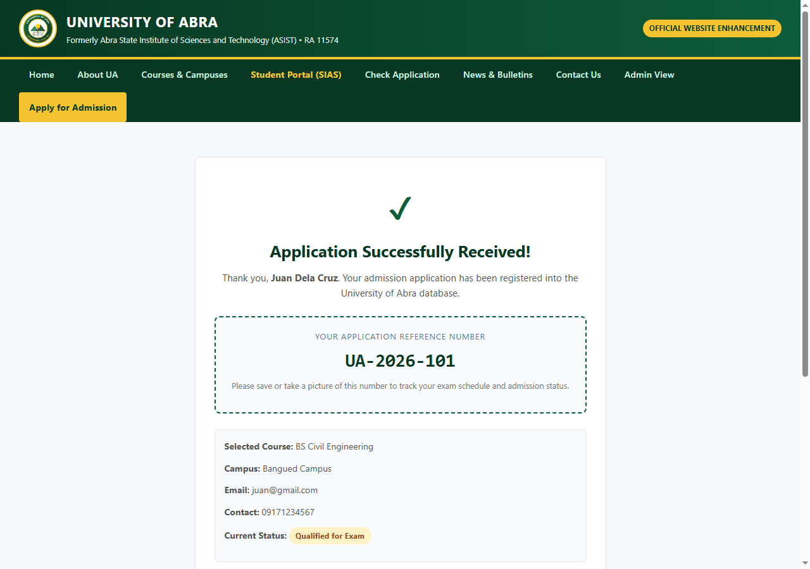

#### About & Purpose of the Page:
Provides formal digital confirmation that the application has been saved and generates an official admission slip for the applicant.

#### Limitations of the Original Website (`asist.edu.ph`):
* Applicants receive no immediate reference number or digital receipt upon submitting documents; everything is handled through manual paper slips.

#### Specific Enhancements Implemented in This Project:
1. **Prominent Reference Number (ARN):** Displays the unique reference code (e.g. `UA-2026-101`) in an eye-catching dashed container.
2. **Applicant Dossier Summary:** Summarizes the applicant's submitted course, campus, contact details, and initial status (*Pending Review*).
3. **One-Click Printable Slip:** An integrated **"Print Confirmation"** button triggers the browser's native `window.print()` functionality, allowing the applicant to print a clean paper slip or save as PDF for testing day.
4. **Seamless Navigation:** Provides instant button shortcuts to the Status Tracker or back to Home.

---

### PAGE 7: ADMISSION STATUS TRACKER
* **URL Route:** `http://127.0.0.1:5000/status`
* **Template File:** `templates/status.html`
* **HTTP Methods:** `GET`, `POST` | **Controller Function:** `status()` in `app.py`
* **Database Table Queried:** `applicants`

#### Page Screenshot:
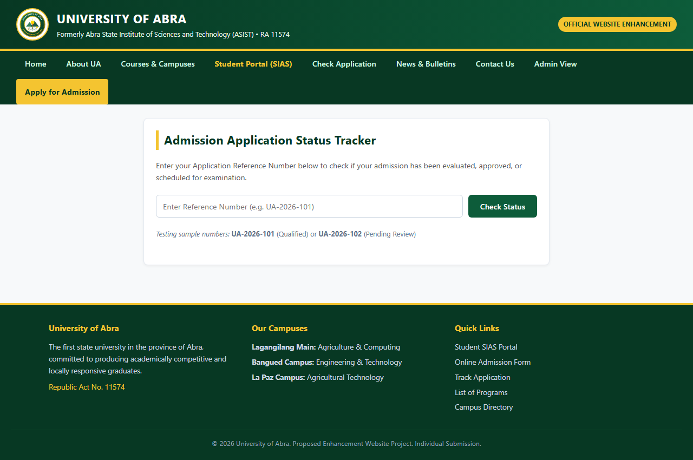

#### About & Purpose of the Page:
Allows applicants to check their evaluation progress and entrance examination schedule online at any time.

#### Limitations of the Original Website (`asist.edu.ph`):
* Applicants have no way to verify their admission status online; they must call registrar landlines or check physical bulletin boards outside campus buildings.

#### Specific Enhancements Implemented in This Project:
1. **Instant Reference Search:** Applicants simply enter their Reference Number (`UA-2026-101`) to look up their record.
2. **Visual Status Badges:** Color-coded status indicators:
   * *Yellow Badge:* `Pending Review` (Documents under assessment).
   * *Blue Badge:* `Qualified for Exam` (Admitted to take the UACAT entrance test).
   * *Green Badge:* `Admitted` (Officially accepted for enrollment).
3. **Official Registrar Remarks Box:** Displays specific, evaluator-written instructions, including testing room number, test date, and required physical documents to bring.
4. **Sample Numbers for Testing:** Displays clickable sample numbers for quick evaluator testing during presentations.

---

### PAGE 8: STUDENT PORTAL LOGIN (UNAUTHENTICATED)
* **URL Route:** `http://127.0.0.1:5000/portal`
* **Template File:** `templates/portal_login.html`
* **HTTP Methods:** `GET`, `POST` (`/portal/login`)
* **Controller Function:** `portal()` / `portal_login()` in `app.py`

#### Page Screenshot:
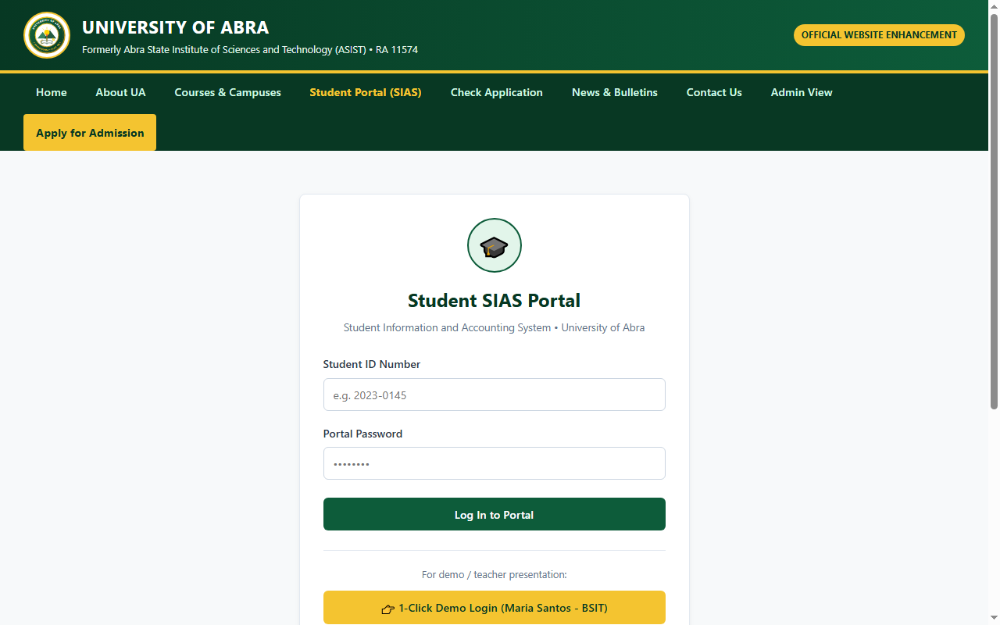

#### About & Purpose of the Page:
The official authentication gate for enrolled university students accessing the Student Information and Accounting System (SIAS).

#### Limitations of the Original Website (`asist.edu.ph`):
* Links to the student portal on `asist.edu.ph` are frequently broken, unstyled, or lead to raw IP addresses with security warnings that intimidate students.

#### Specific Enhancements Implemented in This Project:
1. **Clean Institutional Login Interface:** Styled with the university's green branding and clear typography.
2. **Session-Based Authentication:** Uses secure Flask sessions to maintain login state.
3. **1-Click Demo Login Button:** Includes an instant demo button labeled *"👉 1-Click Demo Login (Maria Santos - BSIT)"* that bypasses manual typing during class presentations and defenses.

---

### PAGE 9: STUDENT PORTAL DASHBOARD (AUTHENTICATED)
* **URL Route:** `http://127.0.0.1:5000/portal`
* **Template File:** `templates/portal.html`
* **HTTP Method:** `GET` | **Controller Function:** `portal()` in `app.py`
* **Database Tables Queried:** `students`, `student_grades`

#### Page Screenshot:
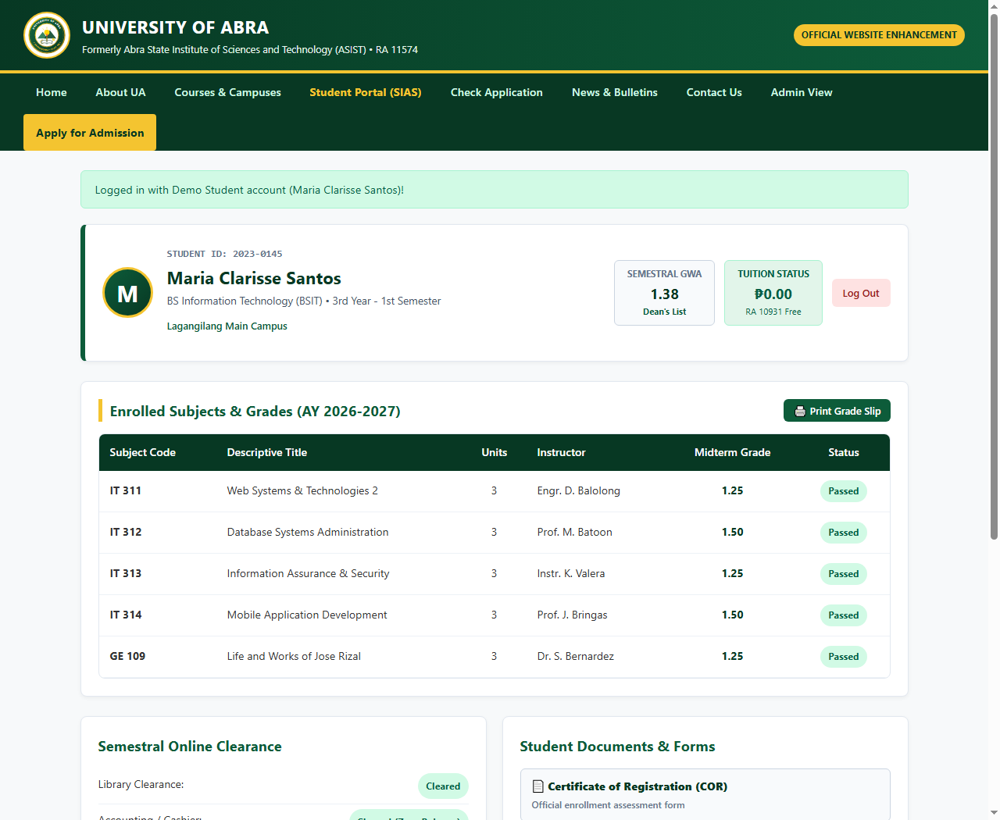

#### About & Purpose of the Page:
The comprehensive self-service academic dashboard for officially enrolled students.

#### Limitations of the Original Website (`asist.edu.ph`):
* Existing SIAS interface is dated, non-responsive, difficult to read on mobile phones, lacks GWA calculation displays, and does not provide an online clearance tracker.

#### Specific Enhancements Implemented in This Project:
1. **Student Profile Header:** Displays the student's avatar initial, full name (*Maria Clarisse Santos*), ID number (`2023-0145`), degree (*BSIT*), campus (*Lagangilang*), and year standing (*3rd Year*).
2. **Semestral GWA Honor Metric:** Automatically displays the calculated General Weighted Average (**1.38**) with a prestigious **Dean's List** honor badge.
3. **Zero Tuition Balance Indicator:** Displays a clear **₱0.00** balance badge confirming full coverage under Republic Act No. 10931.
4. **Enrolled Subjects & Midterm Grades Table:** Displays real enrolled subjects (*Web Systems, Database Administration, Mobile App Dev, etc.*) with unit counts, instructors, and midterm grades.
5. **Multi-Department Online Clearance Checklist:** Live status tracking across five offices (*Library, Cashier, Guidance, College Dean, and University Registrar*).
6. **Downloadable Student Documents:** Instant links to download the Certificate of Registration (COR), TOR Request Slip, and Student Handbook.
7. **Print Grade Slip Feature:** One-click button to print or export the grade sheet as a PDF document.

---

### PAGE 10: CAMPUS NEWS & BULLETINS
* **URL Route:** `http://127.0.0.1:5000/news`
* **Template File:** `templates/news.html`
* **HTTP Method:** `GET` | **Controller Function:** `news()` in `app.py`
* **Database Table Queried:** `announcements`

#### Page Screenshot:
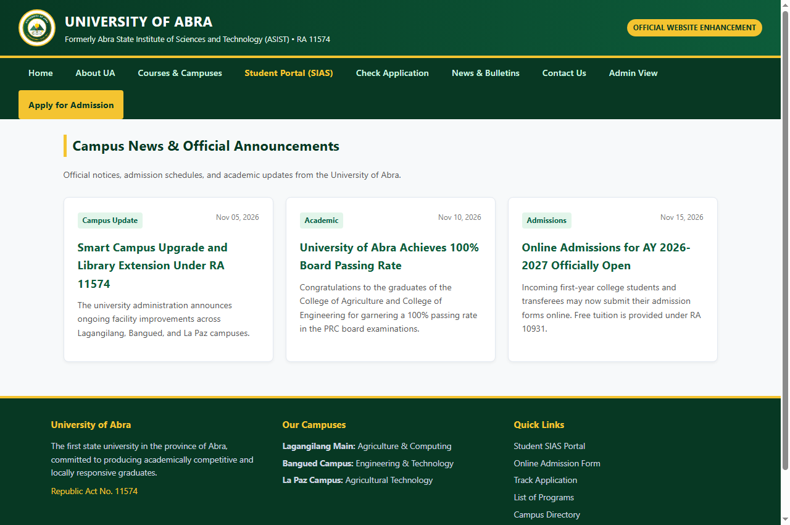

#### About & Purpose of the Page:
The official announcements and university press releases board.

#### Limitations of the Original Website (`asist.edu.ph`):
* Announcements on the current site are poorly formatted, lack categories, and mix administrative memos with general public news without timestamps.

#### Specific Enhancements Implemented in This Project:
1. **Card-Based News Grid:** Clean cards featuring category tags (*Admissions*, *Academic*, *Campus Update*), posting dates, headlines, and detailed article text.
2. **Timely University Bulletins:** Highlights key institutional milestones such as opening of online admissions, 100% board passing achievements, and campus upgrades under RA 11574.
3. **Database-Driven Publishing:** News items are queried dynamically from the `announcements` SQLite table.

---

### PAGE 11: CONTACT US & CAMPUS DIRECTORY
* **URL Route:** `http://127.0.0.1:5000/contact`
* **Template File:** `templates/contact.html`
* **HTTP Methods:** `GET`, `POST` | **Controller Function:** `contact()` in `app.py`
* **Database Table Updated:** `inquiries`

#### Page Screenshot:
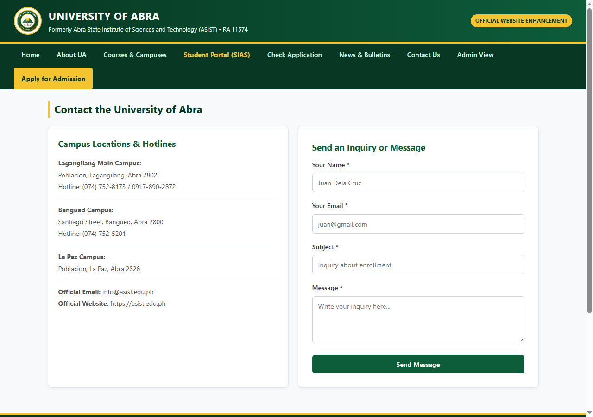

#### About & Purpose of the Page:
Provides complete campus contact information and an interactive public inquiry/feedback form.

#### Limitations of the Original Website (`asist.edu.ph`):
* Only lists an outdated general landline number that is often unreachable.
* Provides no interactive messaging form, forcing users to use third-party email clients.

#### Specific Enhancements Implemented in This Project:
1. **Comprehensive 3-Campus Directory:** Detailed physical addresses and active telephone hotlines for Lagangilang Main, Bangued Campus, and La Paz Campus.
2. **Official Digital Contacts:** Official email (`info@asist.edu.ph`) and reference domain.
3. **Working Interactive Inquiry Form:** Users can enter their Name, Email, Subject, and Message.
4. **Database Logging:** Form submissions are saved directly into the `inquiries` database table, and the user receives a confirmation banner.

---

### PAGE 12: ADMIN & EVALUATOR VIEW
* **URL Route:** `http://127.0.0.1:5000/admin`
* **Template File:** `templates/admin.html`
* **HTTP Methods:** `GET`, `POST` (`/admin/update/<id>`)
* **Controller Function:** `admin()` / `admin_update()` in `app.py`
* **Database Tables Queried/Updated:** `applicants`, `inquiries`

#### Page Screenshot:
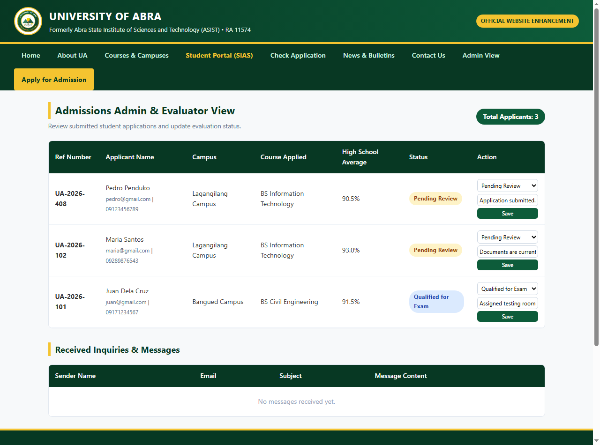

#### About & Purpose of the Page:
An administrative portal for admissions evaluators and faculty to manage submitted applications and monitor citizen inquiries.

#### Limitations of the Original Website (`asist.edu.ph`):
* The university has no public-facing administrative interface for online submissions; registrars rely on paper logbooks or offline spreadsheets.

#### Specific Enhancements Implemented in This Project:
1. **Total Applicants Counter:** Live counter displaying the total volume of registered applicants.
2. **Applicant Dossier Management Table:** Lists applicant reference numbers, names, chosen courses, campuses, and high school GPA averages.
3. **Inline Status Updater:** Evaluators can select a new status (*Pending Review*, *Qualified for Exam*, *Admitted*), type custom remarks (such as testing room number), and click **"Save"** to execute a SQL `UPDATE`.
4. **Public Inquiries Viewer:** Displays all messages submitted through the Contact Us page for administrative tracking.

---

## 3. SUMMARY MATRIX: OLD WEBSITE LIMITATIONS VS. NEW ENHANCEMENTS

| Page / Feature | Old Website (`asist.edu.ph`) | Our Enhanced Solution |
| :--- | :--- | :--- |
| **Theme & Branding** | Dated, inconsistent templates, low contrast. | Official University of Abra Green (`#0d5c3a`) & Gold (`#f4c430`), vector seal, and RA 11574 tags. |
| **Responsiveness** | Breaks on mobile phones and small screens. | 100% fluid responsive design for phones, tablets, and PCs. |
| **Course Explorer** | Unorganized, static lists mixing all campuses. | Card-based catalog with an interactive campus filter dropdown. |
| **Admissions** | Manual, in-person paper applications only. | Full online admission application with instant ARN issuance. |
| **Application Tracking** | In-person bulletin board inquiry only. | Real-time online tracker by reference number with room notices. |
| **Student SIAS Portal** | Broken, unstyled external links. | Integrated dashboard with subjects, midterm grades, GWA, clearance, and COR. |
| **Free Tuition Notices** | Missing or obscure. | Prominent Republic Act No. 10931 zero-tuition guarantee badges. |
| **Administration** | Offline paper records / spreadsheets. | Web-based Admin console to review and update applicant records. |

---

## 4. DATABASE ARCHITECTURE & DATA DICTIONARY

All data is stored in **SQLite3** (`ua_school.db`) managed via `database.py`:

```
+-----------------------------------------------------------------------------------+
|                               DATABASE: ua_school.db                              |
+-----------------------------------------------------------------------------------+

 1. TABLE: programs (Academic Degree Catalog)
    - id              : INTEGER (Primary Key, Autoincrement)
    - code            : TEXT (e.g. 'BSIT', 'BSCE', 'BSA')
    - title           : TEXT (e.g. 'BS Information Technology')
    - campus          : TEXT (e.g. 'Lagangilang Campus', 'Bangued Campus')
    - department      : TEXT (e.g. 'College of Computing Sciences')
    - years           : TEXT (e.g. '4 Years')
    - description     : TEXT (Curriculum overview)

 2. TABLE: applicants (Admission Applications)
    - id              : INTEGER (Primary Key, Autoincrement)
    - ref_number      : TEXT (Unique Reference Number, e.g. 'UA-2026-101')
    - fullname        : TEXT (Applicant's complete name)
    - email           : TEXT (Contact email)
    - contact         : TEXT (Mobile phone number)
    - campus          : TEXT (Chosen campus)
    - course          : TEXT (Chosen degree program)
    - prev_school     : TEXT (High school attended)
    - average         : TEXT (GPA percentage, e.g. '91.50')
    - status          : TEXT ('Pending Review', 'Qualified for Exam', 'Admitted')
    - remarks         : TEXT (Evaluator notes / exam schedule details)

 3. TABLE: students (Enrolled Student Accounts for Portal)
    - id              : INTEGER (Primary Key, Autoincrement)
    - student_id      : TEXT (Unique ID, e.g. '2023-0145')
    - password        : TEXT (Account password)
    - fullname        : TEXT (Student name)
    - course          : TEXT (Enrolled program)
    - campus          : TEXT (Assigned campus)
    - year_level      : TEXT (Year & semester standing)
    - gwa             : TEXT (Semestral GWA, e.g. '1.38')

 4. TABLE: student_grades (Course Grades per Student)
    - id              : INTEGER (Primary Key, Autoincrement)
    - student_id      : TEXT (Foreign reference to student_id)
    - subject_code    : TEXT (e.g. 'IT 311')
    - subject_title   : TEXT (e.g. 'Web Systems & Technologies 2')
    - units           : INTEGER (Unit credits, e.g. 3)
    - grade           : TEXT (Midterm grade, e.g. '1.25')
    - instructor      : TEXT (Instructor name)

 5. TABLE: announcements (Campus News Bulletins)
    - id              : INTEGER (Primary Key, Autoincrement)
    - title           : TEXT (Headline)
    - date_posted     : TEXT (Date string)
    - category        : TEXT (Category tag)
    - content         : TEXT (Full article body)

 6. TABLE: inquiries (Public Contact Messages)
    - id              : INTEGER (Primary Key, Autoincrement)
    - name            : TEXT (Sender's name)
    - email           : TEXT (Sender's email)
    - subject         : TEXT (Inquiry subject)
    - message         : TEXT (Message body)
```

---

## 5. ORAL DEFENSE PRESENTATION GUIDE & TALKING POINTS

When presenting this project to your professor, use this step-by-step presentation structure:

1. **Introduction:**
   > *"Good day, Sir/Ma'am! My project is an individual enhancement of the official website of the University of Abra (UA), formerly ASIST, under Republic Act No. 11574. I chose this website because its current version at asist.edu.ph has an outdated, non-responsive design and completely lacks online admission and status tracking capabilities."*

2. **Demonstrating the Homepage & Courses:**
   > *"I enhanced the design using the university's official Green and Gold colors. On the Courses page, I added an interactive campus filter so students can easily see whether a course is offered in Lagangilang, Bangued, or La Paz."*

3. **Demonstrating the Admissions Flow:**
   > *"I developed a paperless admission form on `/apply`. When an applicant submits their information, Flask generates an official reference number like `UA-2026-101` and saves it into SQLite. The applicant can then print their confirmation slip or go to `/status` to track their evaluation and exam room assignments."*

4. **Demonstrating the Student SIAS Portal:**
   > *"On `/portal`, I built an integrated Student Portal for enrolled students. Using the demo login, we can see real enrolled subjects, midterm grades, semestral GWA of 1.38 (Dean's list honors), online clearance across five offices, and downloadable documents like the Certificate of Registration (COR)."*

5. **Demonstrating the Admin Console:**
   > *"Finally, on `/admin`, the admissions evaluator can view all applicants in a table, change their status from 'Pending' to 'Qualified for Exam', add room remarks, and click Save to update the database in real time."*
